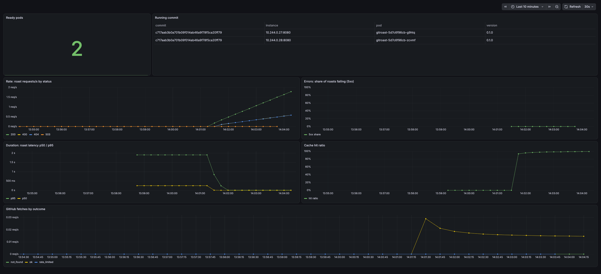

# Evidence

Output captured from the running system on a local kind cluster. Captured on
18 Oct 2026 unless marked otherwise. The cluster runs the image built by CI
from the final commit `c717aab3b0a701b09f014ab46a9f78f5ca20ff79`.

- [1. Working application](#1-working-application)
- [2. Kubernetes setup](#2-kubernetes-setup)
- [3. CI](#3-ci)
- [4. CD and release control](#4-cd-and-release-control)
- [5. Observability](#5-observability)
- [6. Security](#6-security)

---

## 1. Working application

Through the Kubernetes Service (`kubectl -n gitroast port-forward svc/gitroast 8080:80`):

```
$ curl -s localhost:8080/roast/torvalds
{
    "login": "torvalds",
    "name": "Linus Torvalds",
    "score": 8,
    "summary": "Decent. That's the nicest insult I have.",
    "burns": [
        "No bio. Even your own profile has nothing to say about you.",
        "88% C. A one-trick pony, and the trick is mid."
    ]
}

$ curl -s localhost:8080/healthz; curl -s localhost:8080/readyz
ok
ready

$ curl -s -w " %{http_code}" localhost:8080/roast/-bad
{"error":"not a valid GitHub username"} 400

$ curl -s localhost:8080/metrics | grep gitroast_build_info
gitroast_build_info{commit="c717aab3b0a701b09f014ab46a9f78f5ca20ff79",version="0.1.0"} 1
```

Logs are one JSON line per request (`kubectl -n gitroast logs deploy/gitroast --tail=3`):

```
{"duration_ms":0.025375,"event":"request","level":"info","method":"GET","path":"/roast/sindresorhus","status":200,"ts":1792312495.7269504}
{"duration_ms":0.010665999999999998,"event":"request","level":"info","method":"GET","path":"/roast/zz-nobody-here-9","status":404,"ts":1792312495.7327206}
{"duration_ms":0.004125,"event":"request","level":"info","method":"GET","path":"/nope","status":404,"ts":1792312495.736707}
```

---

## 2. Kubernetes setup

```
$ kubectl get nodes
NAME                     STATUS   ROLES           AGE     VERSION
gitroast-control-plane   Ready    control-plane   2d23h   v1.37.0

$ kubectl -n gitroast get deploy,pods,svc
NAME                       READY   UP-TO-DATE   AVAILABLE   IMAGES
deployment.apps/gitroast   2/2     2            2           ghcr.io/ankur-kalita/gitroast:c717aab3b0a701b09f014ab46a9f78f5ca20ff79

NAME                            READY   STATUS    RESTARTS
pod/gitroast-5d7c6f96cb-g9htq   1/1     Running   0
pod/gitroast-5d7c6f96cb-zcvmf   1/1     Running   0

NAME               TYPE        CLUSTER-IP     PORT(S)
service/gitroast   ClusterIP   10.96.39.238   80/TCP
```

Live Deployment settings (read back from the cluster, not from the chart):

```
strategy:                 {"rollingUpdate": {"maxSurge": 1, "maxUnavailable": 0}, "type": "RollingUpdate"}
livenessProbe:            GET /healthz on port http, every 10s
readinessProbe:           GET /readyz on port http, every 5s
resources:                {"requests": {"cpu": "50m", "memory": "32Mi"}, "limits": {"memory": "128Mi"}}
QoS class:                Burstable
GITHUB_TOKEN source:      {"secretKeyRef": {"name": "gitroast-github", "key": "token", "optional": true}}
```

Self-healing (15 Oct): a pod was deleted with `kubectl delete pod`; the
Deployment had a replacement `Running` within ~6 seconds.

In-cluster DNS (15 Oct), from a temporary curl pod:

```
$ curl -s http://gitroast.gitroast.svc.cluster.local/healthz
ok
```

---

## 3. CI

Every push runs `.github/workflows/ci.yml`. All runs on the PR branch passed:

| Result | Commit | Event | Run |
|--------|--------|-------|-----|
| success | `c717aab` | pull_request | [38712412356](https://github.com/ankur-kalita/gitroast/actions/runs/38712412356) |
| success | `c717aab` | push | [38712171585](https://github.com/ankur-kalita/gitroast/actions/runs/38712171585) |
| success | `138d817` | push | [38711777321](https://github.com/ankur-kalita/gitroast/actions/runs/38711777321) |
| success | `412e80b` | push | [38710066134](https://github.com/ankur-kalita/gitroast/actions/runs/38710066134) |
| success | `d250e78` | push | [38708175095](https://github.com/ankur-kalita/gitroast/actions/runs/38708175095) |

Jobs for the final commit:

```
success  Lint                            32s   cargo fmt --check, cargo clippy -D warnings
success  Test                            35s   cargo test --locked (24 tests)
success  Build, scan and publish image  129s   needs: [lint, test]
```

Published image (one per pushed commit, tagged with the full SHA), pulled
anonymously:

```
$ docker pull ghcr.io/ankur-kalita/gitroast:c717aab3b0a701b09f014ab46a9f78f5ca20ff79
ghcr.io/ankur-kalita/gitroast:c717aab3b0a701b09f014ab46a9f78f5ca20ff79
```

Package page: https://github.com/ankur-kalita/gitroast/pkgs/container/gitroast

---

## 4. CD and release control

Deploy = one command with the commit SHA CI published:

```
helm upgrade gitroast charts/gitroast -n gitroast --set image.tag=<sha> --set monitoring.enabled=true --wait
```

### Zero-downtime rolling update

A pod inside the cluster called the Service every 50 ms for 60 s while the
release was upgraded:

| Date | Upgrade | Requests | Failed |
|------|---------|----------|--------|
| 15 Oct | `d250e78` → `412e80b` | 988 | **0** |
| 18 Oct | `138d817` → `c717aab` | 1018 | **0** |

```
$ helm upgrade gitroast charts/gitroast -n gitroast --set image.tag=c717aab3b0a701b09f014ab46a9f78f5ca20ff79 --set monitoring.enabled=true --wait
STATUS: deployed
REVISION: 8
$ kubectl -n gitroast rollout status deploy/gitroast
deployment "gitroast" successfully rolled out
$ kubectl -n gitroast logs loadgen
ok=1018 fail=0
```

### Bad release and rollback (15 Oct)

1. Deployed a tag that does not exist (`image.tag=does-not-exist`).
2. The new pod went to `ImagePullBackOff`; `helm upgrade --wait` timed out and
   marked the release **failed**.
3. Because of `maxUnavailable: 0`, the two old pods were never removed:

```
POD                         STATUS             READY   IMAGE
gitroast-76457577cc-969lc   ImagePullBackOff   false   ghcr.io/ankur-kalita/gitroast:does-not-exist
gitroast-798cc4bb74-fgv7j   <none>             true    ghcr.io/ankur-kalita/gitroast:412e80bf...
gitroast-798cc4bb74-hdwvj   <none>             true    ghcr.io/ankur-kalita/gitroast:412e80bf...

requests to the Service during the bad release:
200 200 200 200 200 200 200 200 200 200 200 200 200 200 200 200 200 200 200 200
```

4. `helm rollback gitroast 2 -n gitroast --wait` → both pods Ready on
   `412e80b`, bad pod removed.

### Release history (traceability)

```
$ helm history gitroast -n gitroast
REVISION  STATUS      DESCRIPTION
1         superseded  Install complete                                (d250e78)
2         superseded  Upgrade complete                                (412e80b)
3         failed      Upgrade failed: Deployment not ready            (does-not-exist)
4         superseded  Rollback to 2                                   (412e80b)
5         failed      Upgrade failed: PrometheusRule rejected by the admission webhook
6         superseded  Upgrade complete                                (monitoring enabled)
7         superseded  Upgrade complete                                (138d817)
8         superseded  Upgrade complete                                (c717aab)
9         deployed    Upgrade complete                                (dashboard panel update)
```

Revision 5 was a real mistake: `--reuse-values` dropped a new chart value,
leaving an alert expression incomplete. The operator's admission webhook
rejected it and nothing changed in the cluster. Fixed by passing values
explicitly (revision 6).

---

## 5. Observability

Prometheus and Grafana installed with kube-prometheus-stack
(`deploy/monitoring-values.yaml`). The chart adds a ServiceMonitor, alert
rules and a dashboard:

```
$ kubectl -n gitroast get servicemonitor,prometheusrule,configmap -l app.kubernetes.io/name=gitroast
servicemonitor.monitoring.coreos.com/gitroast
prometheusrule.monitoring.coreos.com/gitroast
configmap/gitroast-dashboard
```

### Grafana dashboard



Panels: ready pods, running commit per pod, request rate by status, 5xx
error share, p50/p95 latency, cache hit ratio, GitHub fetches by outcome.
The latency and cache panels show the cache warming up: p95 falls from ~1.9s
to ~5ms as the hit ratio goes to ~100%.

### Prometheus queries (RED: rate, errors, duration)

```
up{namespace="gitroast"}                               both pods: 1
roast requests/s by status                             200: 2.182   400: 0.715   404: 0.715
5xx share of roasts                                    no 5xx series in the window (0%)
p95 roast latency                                      0.005 s
cache hit ratio                                        0.994
GitHub fetches by outcome (since pods started)         ok: 6   not_found: 2
```

Traffic was 3 real users and 1 missing user, spread over 2 pods. 8 GitHub
fetches = exactly one per user per pod; every repeat was a cache hit,
including the missing user.

### Alerts

```
GitroastHighErrorRate  health=ok  state=inactive   roast 5xx share > 5% for 5m
GitroastNoReadyPods    health=ok  state=inactive   available replicas < 1 for 2m
```

On 15 Oct, testing used up GitHub's 60 unauthenticated requests/hour.
Roasts returned 503, `gitroast_github_fetches_total{outcome="rate_limited"}`
rose, the pods stayed Ready (probes don't depend on GitHub), and
`GitroastHighErrorRate` went to **pending** on its own. It cleared when the
limit reset.

### A fix driven by metrics

On 15 Oct the GitHub outcome metric showed `not_found: 55` against `ok: 4`:
missing usernames were not cached, so every retry called GitHub. Commit
`138d817` caches 404s too (not 503/502, which should be retried). Verified on
one pod after deploying:

```
5 requests for /roast/zz-evidence-typo-42 → 404 404 404 404 404
gitroast_cache_lookups_total{result="hit"} 4
gitroast_cache_lookups_total{result="miss"} 1
gitroast_github_fetches_total{outcome="not_found"} 1
```

---

## 6. Security

### Image

```
$ trivy image --severity HIGH,CRITICAL --ignore-unfixed ghcr.io/ankur-kalita/gitroast:c717aab3b0a701b09f014ab46a9f78f5ca20ff79
│ ghcr.io/ankur-kalita/gitroast:c717aab... (debian 12.15) │ debian │ 0 │
exit code: 0

$ docker inspect <image> --format '{{.Config.User}}'
65532:65532

$ docker run --rm --entrypoint sh <image>
... exec: "sh": executable file not found in $PATH
```

Distroless runtime, 44 MB, no shell or package manager, non-root. The same
Trivy scan runs in CI and blocks publishing on any fixable HIGH/CRITICAL.

### Pod (read back from the cluster)

```
pod securityContext:        {"runAsNonRoot": true, "runAsUser": 65532, "runAsGroup": 65532, "seccompProfile": {"type": "RuntimeDefault"}}
container securityContext:  {"allowPrivilegeEscalation": false, "readOnlyRootFilesystem": true, "capabilities": {"drop": ["ALL"]}}
automountServiceAccountToken: false
```

### CI permissions

```yaml
permissions:
  contents: read          # whole workflow
jobs:
  image:
    permissions:
      contents: read
      packages: write     # only the job that publishes
```

GHCR login uses the per-run `GITHUB_TOKEN`; no registry password is stored.
Pull requests are built and scanned but never published.

### Secrets

- `GITHUB_TOKEN` for the app is only ever a Kubernetes Secret created by
  hand (`kubectl create secret`), referenced by name and optional. It is not
  in git, the image, the chart or CI.
- Every commit in the PR was scanned for token, key and password patterns.
  The only match is the `ghp_...` placeholder in the README, which was already
  in the baseline.
- Grafana and Prometheus are not exposed outside the cluster; the Service is
  ClusterIP and is reached with `kubectl port-forward`.
